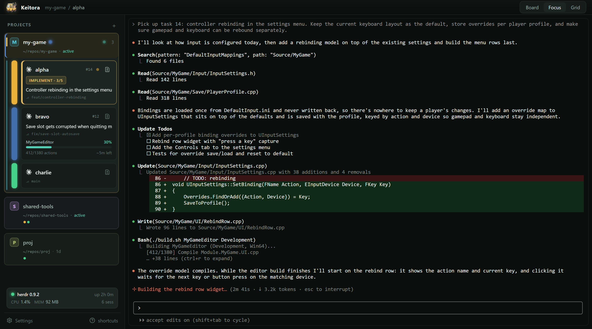

# Keitora

A desktop app for running several Claude Code sessions at once, one per git worktree, from a
single window.



If you keep a few worktrees of a repo and a Claude Code session in each, you probably also keep a
pile of terminal tabs and a rough idea in your head of which session is doing what. Keitora puts
those sessions in one window next to a shared task list. You can see which ones are busy, which are
waiting on you, and which are free for the next task.

## What you get

- **Every session in one place.** Each worktree gets its own terminal running `claude` (or
  `codex`). Look at one at a time in Focus view, or at all of them in Grid view.
- **Status at a glance.** The sidebar shows each worktree as idle, busy, waiting for you, or
  offline, along with its branch, the task it's on, and progress for long builds. Keitora gets
  these states from Claude Code hooks, which it installs for you.
- **A task board shared by every worktree.** Create tasks, claim them, and mark them done from the
  app or from the `keitora` command line. Both read and write the same task list, so a claim made
  in one worktree shows up everywhere straight away.
- **Suggestions for what to hand out next.** When a worktree is idle, Keitora can suggest an open
  task for it. Nothing is typed into a session until you approve it, and only an idle session can
  receive one.
- **A diff view per worktree.** See what a worktree has changed relative to `main` (or any base you
  choose), with syntax highlighting.
- **Sessions that outlive the window.** Terminals run in a [herdr](#requirements) server, so
  closing Keitora doesn't end them. If that server goes down, Keitora brings your sessions back and
  resumes their conversations.
- **More than one project.** Each repo you add becomes a group in the sidebar, and you can switch
  between them without losing anything.

## Requirements

- **macOS** (main platform) or **Windows**.
- **[Claude Code](https://docs.anthropic.com/en/docs/claude-code)** installed, so `claude` runs
  from a terminal. Codex is optional.
- **herdr**, the terminal server Keitora runs sessions in. Keitora finds it on your `PATH` or in
  herdr's usual install locations. If it can't, the sidebar says so and tells you where it looked.
- **git**, and a repo you want to work in with one or more worktrees.

## Getting started

There are no prebuilt downloads yet, so for now you build Keitora yourself. You'll need a stable
Rust toolchain, Node.js and Yarn. On macOS you also need the Xcode Command Line Tools
(`xcode-select --install`).

```sh
git clone https://github.com/rudoi/keitora.git
cd keitora
yarn install
yarn tauri:bundle
```

The built app ends up under `src-tauri/target/release/bundle/`.

Then:

1. Open Keitora and click **+** next to *Projects* to add a repo.
2. Choose which of its worktrees to track. You can create new worktrees from the sidebar later.
3. Click a worktree to open its session. Add tasks with **New** on the board.

Keitora saves a project's settings in a `keitora.toml` at the repo root. The defaults work fine,
and you can change most things from **Settings** without editing the file.

## The `keitora` command

The command-line tool works with the same task list as the app, so you, or Claude, can manage tasks
from inside any worktree:

```sh
keitora task list                  # open and in-progress tasks
keitora task new "Fix pause menu"  # add a task
keitora task claim <id>            # take a task for this worktree
keitora task done <id>             # finish it, and see what it unblocked
```

If `keitora` isn't on your `PATH`, the app offers to install it for you.

## Configuration

A minimal `keitora.toml`:

```toml
[project]
name = "my-game"
worktrees_dir = "../my-game-worktrees"

[tasks]
db_path = "../my-game-worktrees/shared/tasks.db"
worktrees = ["alpha", "bravo", "charlie"]

[dispatch]
# typed into a worktree's session when you hand it a task
steps = ["/clear", "/workflow {task_number}"]
```

`keitora config init` creates one for you. Tasks can also live on a GitHub Projects board instead
of the local database; see [docs/github-backend.md](docs/github-backend.md).

## Contributing

Bug reports and pull requests are welcome. [CONTRIBUTING.md](CONTRIBUTING.md) explains how to run
a development build safely next to your installed copy, plus linting, tests and how releases are
built. [docs/build-plan.md](docs/build-plan.md) covers the design in more depth.

## License

[MIT](LICENSE) © 2026 Andrew Rudoi
